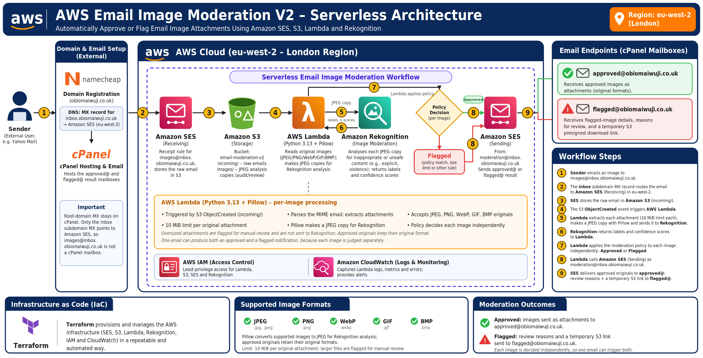

# AWS Email Image Moderation V2

**Serverless Email Image Classification, Moderation and Automated Approval/Flagging**

An AWS serverless application that receives image attachments through email, analyses their content using Amazon Rekognition, and independently classifies each image as **Approved** or **Flagged for Manual Review**.

The application supports five image formats: **JPEG, PNG, WebP, GIF and BMP**. Pillow creates JPEG copies for Amazon Rekognition analysis, while approved images retain their original formats.

The infrastructure is provisioned using **Terraform** in the AWS Europe (London) Region (`eu-west-2`).

## Architecture



### Architecture Workflow

1. **Email Submission:** An external sender emails image attachments to `images@inbox.obiomaiwuji.co.uk`.
2. **Amazon SES (Receiving):** Receives the email through the configured MX record and receipt rule.
3. **Amazon S3:** Stores the original email in the `incoming/` prefix and triggers Lambda through an `ObjectCreated` event.
4. **AWS Lambda:** Parses the MIME email, extracts attachments, validates formats and sizes, and prepares JPEG copies using Pillow.
5. **Amazon Rekognition:** Analyses each image using `DetectModerationLabels`, `DetectLabels` and `DetectText`.
6. **Moderation Decision:** Lambda independently classifies each image as Approved or Flagged according to the configured moderation policy.
7. **Amazon SES (Sending):** Sends the moderation results to the appropriate destination.
8. **cPanel Mailboxes:** Receive approved image attachments or flagged-image review notifications.

### Email Routing

| Purpose | Email address |
|---|---|
| Incoming image submissions | `images@inbox.obiomaiwuji.co.uk` |
| Outgoing moderation sender | `moderation@inbox.obiomaiwuji.co.uk` |
| Approved image destination | `approved@obiomaiwuji.co.uk` |
| Flagged image destination | `flagged@obiomaiwuji.co.uk` |

**Approved images** are delivered as attachments in their original formats.

**Flagged images** generate notifications containing the filename, review reason and a temporary Amazon S3 presigned download link.

An email containing both approved and flagged images can produce two separate outgoing notifications.

## Project Background and Attribution

This project builds upon the **AWS Rekognition Image Moderation** training project introduced by **Digital Cloud Academy** during its DevOps Tools Training programme.

**Original training repository:**

https://gitlab.com/digitalcloudacademy-group/devops-tools-training-group/aws-rekognition-image-moderation.git

The original project provided the foundation for an AWS serverless email image moderation workflow.

For this V2 implementation, I adapted the original architecture and **modified and extended the existing `lambda/handler.py`** to introduce additional image-processing capabilities, independent moderation decisions and separate email routing.

The project also includes updated Terraform infrastructure configuration, a revised architecture diagram, testing and deployment documentation.

### Key Enhancements in V2

1. **Five image formats:** Extended image processing to JPEG, PNG, WebP, GIF and BMP using Pillow.
2. **Image conversion:** Added JPEG conversion for Rekognition analysis while preserving approved original image formats.
3. **Independent image classification:** Each attachment is evaluated separately rather than treating all attachments as one moderation result.
4. **Separate email destinations:** Approved and flagged results are delivered to different cPanel mailboxes.
5. **Mixed-result handling:** A single incoming email can generate both approved and flagged notifications.
6. **Manual-review handling:** Oversized, unsupported or unscannable attachments are directed for review.
7. **Policy-based moderation:** Combined Rekognition moderation labels, general visual labels and detected text to support configurable moderation decisions.
8. **Infrastructure and documentation:** Updated Terraform resources, IAM permissions, deployment configuration, tests and architecture documentation.

These enhancements represent my implementation and extension of the Digital Cloud Academy training project.

## AWS Services and Technologies

| Technology | Purpose |
|---|---|
| Amazon SES | Receives incoming emails and sends moderation notifications |
| Amazon S3 | Stores incoming emails and extracted image objects |
| AWS Lambda | Processes attachments and applies moderation decisions |
| Amazon Rekognition | Analyses image content, moderation labels and text |
| AWS IAM | Controls service permissions using least privilege |
| Amazon CloudWatch | Captures Lambda execution logs and operational metrics |
| Terraform | Provisions and manages AWS infrastructure |
| Python 3.13 | Lambda application runtime |
| Pillow | Validates and converts supported image formats |
| cPanel | Hosts approved and flagged destination mailboxes |
| Namecheap | Domain registration and DNS configuration |

**AWS Region:** `eu-west-2` (Europe — London)

## Supported Image Formats

| Format | Extension | Processing |
|---|---|---|
| JPEG | `.jpg`, `.jpeg` | JPEG copy for analysis |
| PNG | `.png` | Converted to JPEG for analysis |
| WebP | `.webp` | Converted to JPEG for analysis |
| GIF | `.gif` | Converted to JPEG for analysis |
| BMP | `.bmp` | Converted to JPEG for analysis |

Pillow prepares JPEG copies for Rekognition. Approved images are forwarded in their original formats.

The application enforces a **10 MiB limit per original attachment**. Files exceeding this limit are flagged for manual review.

For animated images, the current implementation uses a limited number of frames for analysis rather than performing exhaustive video-style moderation.

## Moderation Policy

The application combines three Amazon Rekognition capabilities:

- `DetectModerationLabels` — identifies potentially inappropriate image content.
- `DetectLabels` — identifies general visual objects and scenes.
- `DetectText` — extracts visible text from images.

The moderation policy can flag images associated with configured categories, including:

- Explicit or sexually suggestive content.
- Violence or visually disturbing content.
- Alcohol-related imagery.
- Political campaign or rally indicators requiring manual review.
- Unsupported, oversized or incompletely scanned attachments.

**Important:** Political content is not inherently harmful. Political campaign and rally detection is a project-specific review policy, not a claim that such content is unsafe.

Amazon Rekognition returns predictions and confidence scores. The application applies its configured rules to determine whether human review is required.

## Project Structure

```text
email-moderation-v2/
├── docs/
│   └── email-image-moderation-v2-architecture.png
├── lambda/
│   ├── handler.py
│   └── requirements.txt
├── scripts/
│   └── build-lambda.sh
├── tests/
│   └── test_handler.py
├── .gitignore
├── cloudwatch.tf
├── iam.tf
├── lambda.tf
├── main.tf
├── outputs.tf
├── s3.tf
├── ses.tf
├── variable.tf
├── versions.tf
├── terraform.tfvars.example
└── README.md
```

Terraform-generated state files, deployment packages and local configuration files are excluded from version control where appropriate.

## Prerequisites

Before deploying the project, ensure the following are available:

1. An AWS account with permission to configure SES, S3, Lambda, Rekognition, IAM and CloudWatch.
2. AWS CLI configured with suitable credentials.
3. Terraform installed.
4. Python 3.13 and the required Python dependencies.
5. A registered domain with DNS management access.
6. A working cPanel email hosting environment.
7. Verified Amazon SES sending identity and suitable SES sending permissions.
8. Amazon SES inbound email receiving configured in a supported AWS Region.

The implementation uses `eu-west-2`.

## Deployment

### 1. Clone the Repository

```bash
git clone <YOUR-GITHUB-REPOSITORY-URL>
cd email-moderation-v2
```

Replace the placeholder with your published GitHub repository URL.

### 2. Configure AWS Credentials

```bash
aws configure
```

Verify the AWS identity:

```bash
aws sts get-caller-identity
```

### 3. Configure Terraform Variables

Create a local configuration file:

```bash
cp terraform.tfvars.example terraform.tfvars
```

Update the values:

```hcl
project_name = "email-moderation-v2"

intake_domain = "inbox.obiomaiwuji.co.uk"

approved_email = "approved@obiomaiwuji.co.uk"
flagged_email  = "flagged@obiomaiwuji.co.uk"

moderation_threshold = 80
link_expiry_seconds  = 3600

enable_receiving = false
```

Keep receiving disabled until the SES identity, DNS configuration and infrastructure are ready.

**Do not commit `terraform.tfvars` or AWS credentials to GitHub.**

### 4. Build the Lambda Deployment Package

Run the project build script:

```bash
bash scripts/build-lambda.sh
```

This prepares the Lambda deployment package with the required application dependencies.

### 5. Initialise Terraform

```bash
terraform init
```

### 6. Format and Validate

```bash
terraform fmt
terraform validate
```

### 7. Review the Deployment Plan

```bash
terraform plan -out=tfplan
```

### 8. Deploy the Infrastructure

```bash
terraform apply "tfplan"
```

### 9. Configure DNS and Verify SES

Inspect the Terraform outputs:

```bash
terraform output
```

Configure the required SES verification, DKIM and MX records using the DNS values provided.

The `inbox.obiomaiwuji.co.uk` subdomain routes incoming moderation emails to Amazon SES.

The root-domain mailboxes remain hosted on cPanel.

Wait for SES verification and DNS propagation before enabling receiving.

### 10. Enable Email Receiving

Change the local Terraform configuration to:

```hcl
enable_receiving = true
```

Then run:

```bash
terraform plan -out=tfplan
terraform apply "tfplan"
```

This enables the SES receiving configuration managed by Terraform.

## Testing and Validation

### Test 1: Independent Classification of PNG Images

An email containing three PNG attachments was submitted:

- A labelled political rally image.
- An unlabelled political rally image.
- An apple image.

**Observed result:**

- One image was flagged for manual review.
- Two images were approved.
- Separate emails were received in the corresponding cPanel mailboxes.

This demonstrated independent image classification and separation of approved and flagged results.

### Test 2: WebP and GIF Support

WebP and GIF versions of an apple image were submitted.

**Observed result:**

- Both images were processed successfully.
- Both were approved.
- Both were delivered to the approved mailbox in their original formats.

This demonstrated processing of additional image formats through Pillow.

### Test 3: Oversized BMP Attachment

A BMP image exceeding the configured 10 MiB limit was submitted.

**Observed result:**

- The image was flagged for manual review.
- The flagged mailbox received a notification containing the filename, reason and temporary S3 review link.

This demonstrated enforcement of the attachment size policy.

### Test 4: SES IAM Permissions

An initial test encountered an `AccessDeniedException` when Lambda attempted to send a moderation email.

The Terraform IAM policy was updated to authorise the relevant SES destination identities.

Subsequent testing confirmed successful delivery to the approved and flagged mailboxes.

### Validation Summary

| Test | Observed result |
|---|---|
| Mixed PNG image classification | Passed |
| Separate approved and flagged routing | Passed |
| WebP image processing | Passed |
| GIF image processing | Passed |
| BMP attachment size enforcement | Passed |
| SES notification delivery after IAM update | Passed |

These results describe the tests conducted during development. They do not constitute exhaustive production validation of all supported formats, moderation categories or failure scenarios.

## Security Considerations

The implementation includes several security controls:

- IAM permissions scoped to the required AWS services and resources.
- S3 public-access blocking.
- Server-side encryption for stored objects.
- Temporary presigned links for flagged-image review.
- Configurable attachment size limits.
- Manual-review handling when image analysis is incomplete.
- CloudWatch logging for operational investigation.
- Git exclusions for local Terraform state and configuration files.

Presigned URLs act as temporary bearer credentials: anyone possessing a valid URL may be able to access the referenced object until the URL or its signing credentials expire.

Sensitive image submissions should be handled in accordance with applicable privacy, data-protection and retention requirements.

## Known Limitations

1. **Moderation accuracy:** Rekognition results depend on model predictions, confidence thresholds and application-specific policy rules. False positives and false negatives are possible.
2. **Attachment size:** Original attachments larger than 10 MiB are flagged instead of being analysed.
3. **Animated images:** GIF processing does not provide exhaustive analysis of every possible animation frame.
4. **Manual review:** The flagged mailbox provides review information, but the project does not currently include a dedicated moderation dashboard.
5. **Delivery reliability:** The application successfully sends moderation notifications, but duplicate notifications may occur if AWS retries an event after a partial processing failure. Future improvements will include idempotency and retry mechanisms to minimise duplicate emails and improve delivery reliability.
6. **Email security:** Additional controls for sender authentication, malicious attachments and retention would be necessary before production deployment.

## Future Improvements

1. **Automated test coverage:** Expand unit and integration tests for all five image formats, mixed moderation outcomes and failure conditions.
2. **Moderation dashboard:** Introduce a web-based interface for reviewing flagged submissions and recording decisions.
3. **Idempotent processing:** Implement a mechanism to track processed email events and avoid duplicate notifications.
4. **Improved notifications:** Add structured moderation reports and clearer review information.
5. **Monitoring and alerting:** Extend CloudWatch monitoring with actionable alerts for processing and delivery failures.
6. **Image and email security:** Strengthen attachment validation, malware screening and access controls.
7. **Operational documentation:** Add deployment troubleshooting, recovery procedures and cost-monitoring guidance.

## Cost Considerations

The project uses AWS services with usage-based pricing.

Potential charges include:

- Amazon SES email receiving and sending.
- Amazon S3 storage and requests.
- AWS Lambda invocations and execution duration.
- Amazon Rekognition image-analysis operations.
- Amazon CloudWatch logs and monitoring.

Review current AWS pricing before deployment and remove unused resources when testing is complete.

To destroy Terraform-managed resources:

```bash
terraform destroy
```

**Warning:** Destruction may be blocked by non-empty S3 buckets or resource protection settings. Review the plan carefully before approving deletion, particularly when stored emails or images must be retained.

## Learning Outcomes

This project demonstrates practical experience in:

- Designing an event-driven AWS serverless architecture.
- Integrating Amazon SES with S3 and Lambda.
- Implementing image classification and moderation using Amazon Rekognition.
- Extending an existing Python Lambda application.
- Using Pillow for multi-format image processing.
- Implementing independent attachment-level decisions.
- Configuring secure IAM permissions.
- Managing infrastructure with Terraform.
- Diagnosing AWS permission and delivery errors.
- Testing email workflows with real cPanel destinations.
- Documenting cloud architecture and deployment procedures.

## Author

**Obioma Iwuji**

AWS Certified Solutions Architect – Associate  
MSc Computer Science  
Cloud Engineering | DevOps | AWS Serverless Architecture

## Acknowledgement

I acknowledge **Digital Cloud Academy** for introducing the original AWS Rekognition Image Moderation project during its DevOps Tools Training programme.

The original training implementation, including its Lambda handler, provided the starting point for this project.

I modified and extended the original `lambda/handler.py` and developed the V2 implementation to support additional image formats, independent image-level moderation, separate approval and review destinations, and an updated deployment architecture.

Original repository:

https://gitlab.com/digitalcloudacademy-group/devops-tools-training-group/aws-rekognition-image-moderation.git

## Licence

The licensing terms of the original Digital Cloud Academy repository have not been confirmed.

This V2 repository does not currently declare an open-source licence. Any reused third-party code remains subject to its original licensing terms and applicable permissions.
